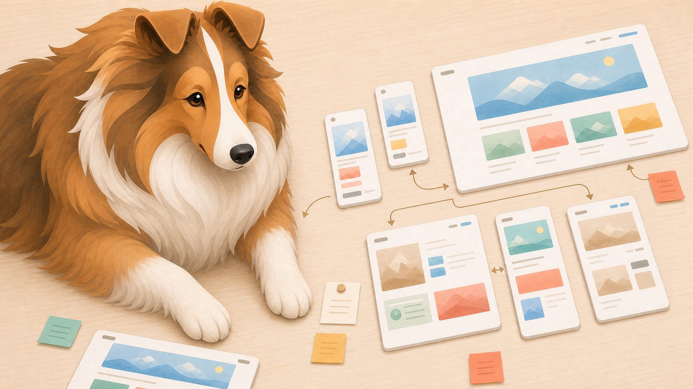
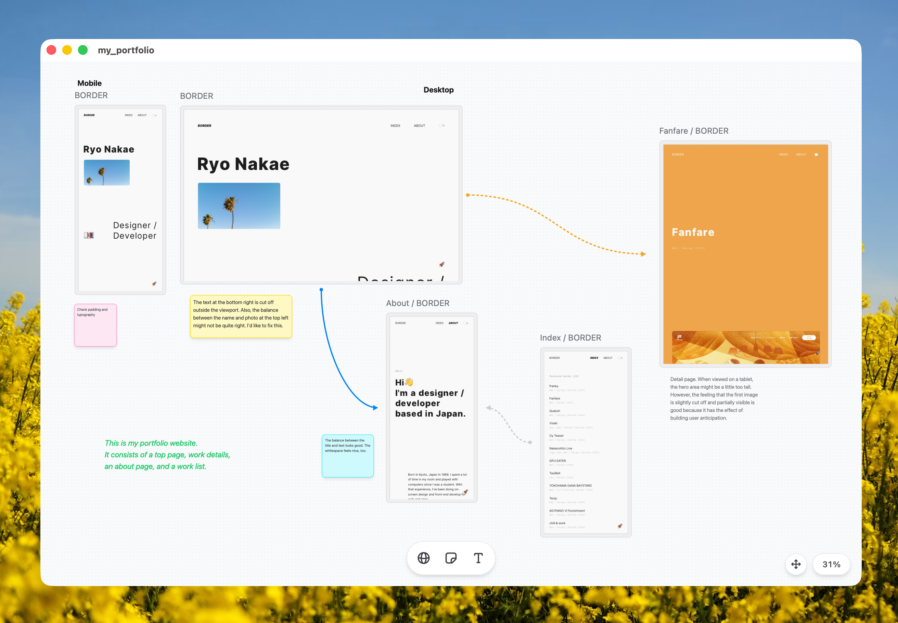

# Sheltie



Sheltie is a macOS app that arranges live web pages on an infinite canvas, so you can review a whole site the way you would review artboards in a design tool.

<!-- README-I18N:START -->

**English** | [日本語](./README.ja.md)

<!-- README-I18N:END -->

## Why I built Sheltie



More teams now use AI coding agents to prototype in code from the start and iterate on the running app. Designers who don't write code are building web apps themselves, with an AI doing the coding.

A browser, though, shows one page at a time. Visual tone across screens, spacing, typography, and the flow between pages are hard to judge without stepping back. Checking them one page at a time takes effort, and for this part of the review you still end up back in Figma or Sketch.

I built Sheltie to fill that gap. It sits somewhere between a browser and a design tool: you arrange web pages on a canvas, zoom out to see the whole picture, and zoom in to work with any page directly.

## What you can do

- **Put running pages on the board:** Each website on the board is a native webview (WebKit, the same engine as Safari). You can scroll and click, the same as in a browser.
- **Step back and compare:** Pan and zoom across the board to spot inconsistencies in spacing, typography, and color across screens.
- **Sketch the flow:** Connect pages with arrows to diagram how screens lead to each other, and leave notes with sticky notes and text.
- **Save and share boards:** A board saves to a `.sheltie` file, so you can track it in Git like any other file. Boards open as native macOS windows and tabs.
- **Pair it with a coding agent:** Sheltie has a built-in local MCP server. Ask an agent like Claude Code to fix a screen, then compare the result right on the board. An Agent Skill is also available to teach agents how to use Sheltie.

## Install

Install with Homebrew:

```bash
brew install --cask ryonakae/tap/sheltie
```

Or download the latest `Sheltie_<version>_universal.dmg` from [GitHub Releases](https://github.com/ryonakae/sheltie/releases), open it, and drag Sheltie into Applications.

Either way you get the same universal binary (Apple Silicon and Intel), signed and notarized.

Sheltie currently supports macOS only.

## Quick start

1. Launch Sheltie and create a new board.
2. Add a web page and enter a URL, either your local dev server (`http://localhost:3000`) or a live site.
3. Add more pages, drag them into place, and zoom out to look at the flow.
4. Connect pages with arrows and drop sticky notes where something needs attention.
5. Save the board as a `.sheltie` file to continue later.

## Use with coding agents (MCP)

Sheltie can also run as an MCP server, so local AI agents can work with the board and its pages. Enable it from **Sheltie › Settings › Enable MCP Server**, then register the endpoint in your MCP client:

```json
{
  "mcpServers": {
    "sheltie": {
      "type": "http",
      "url": "http://127.0.0.1:29978/mcp"
    }
  }
}
```

A connected agent can read the board, operate the pages, and take screenshots.

Note that there is no authentication. The server listens on localhost only, but it trusts any local client that connects, so enable it only on machines you trust.

## Development

Sheltie is built with Tauri v2, React, TypeScript, and Tailwind CSS v4.

```bash
git clone https://github.com/ryonakae/sheltie.git
cd sheltie
npm install
npm run dev
```

Requires Node.js 22 and Rust (version pinned in `mise.toml`). See [AGENTS.md](AGENTS.md) and [docs/agents/](docs/agents/) for architecture notes and contribution guidelines.

## License

[MIT](LICENSE)
